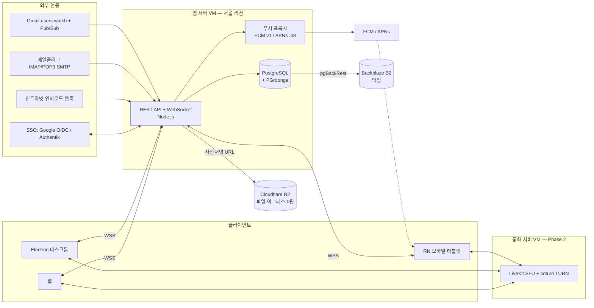

# 사내 메신저 기획서 (v0.1)

> 작성일: 2026-07-02 · 상태: 초안 v0.1.1 (의사결정 대기 항목 있음 — [§12](#12-착수-전-확인-필요-사항) 참조)
>
> **v0.1.1 확정 입력값(2026-07-02)**: 인원 **100~120명** · **Google Workspace 미보유** · 주력 사내 메일 = **메일플러그**.
> → Gmail 연동은 후순위로 강등(§7), SSO 기본안은 Authentik 자가호스팅, 조직도 마스터는 메일플러그/인트라넷.
>
> 이 문서의 모든 가격·정책·제한 수치는 2026-07-02 기준 웹 리서치로 수집하고,
> 기획에 영향이 큰 21건은 별도 사실 검증을 거쳤다(원문: [research/](./research/), 검증 결과: [research/07-fact-checks.md](./research/07-fact-checks.md)).
> 환율 가정: 1 USD ≈ 1,400 KRW.

## 0. 요약 (TL;DR)

- **무엇을**: Slack/Discord를 벤치마크하되 **한국형 요구(읽음 확인·조직도·필독 공지)** 를 1급 기능으로 갖춘 사내 메신저.
  데스크톱(Electron)·모바일·태블릿 지원, **Gmail·메일플러그·인트라넷 연동**이 차별점.
- **어떻게**: TypeScript 모노레포 — **React 웹 + Electron 데스크톱 + React Native(Expo) 모바일/태블릿** (Slack을 제외한 업계 전부가 검증한 조합). 백엔드는 **Node WebSocket + PostgreSQL(+PGroonga 한국어 검색) + Cloudflare R2 + 자체 푸시(FCM/APNs 직접)** 단일 VM 시작.
- **비용**: 월 운영비(서버+스토리지+도메인+애플 연회비 월할) **30명 약 3~5만 원 / 100명 약 5~11만 원 / 300명 약 14~19만 원**. 여기에 연 고정비(애플 $99 + Windows 코드사이닝 OV $220~320) 약 48~62만 원. 실질 최대 비용은 **운영 인력 공수**다.
- **정직한 경고**: 순수 비용 절감이 목적이면 자체 개발은 성립하지 않는다(완전 신규 개발 초기 3~10억 원 추정 vs 300명 SaaS 연 2,300~3,700만 원). 자체 개발의 근거는 **데이터 주권, 무제한 히스토리, 메일플러그·인트라넷 커스텀 연동 자유, 반복되는 SaaS 요금 인상·무료 축소 리스크 차단**이어야 한다. 개발 리소스가 부족하면 **Zulip 자가호스팅 커스터마이징**(기능 페이월 없음)이 최선의 대안이다 — [§2](#2-전략-결정-만들-것인가-빌릴-것인가) 참조.

---

## 1. 배경과 목표

### 1-1. 배경

- 사내 커뮤니케이션이 메일(Gmail/메일플러그)·인트라넷·개인 메신저로 분산되어 있음.
- 상용 SaaS는 2025~2026년에 걸쳐 무료 축소·가격 인상이 반복됨(검증된 사례: 카카오워크 Free 30인 제한 신설 및 2026-07-01 전체 적용, 네이버웍스 Free 100→30명, Slack Business+ $12.50→$15 인상, Mattermost 무료판 250인 제한).
- Slack 무료 플랜은 메시지 90일 노출·1년 후 영구 삭제 — 무료로 상시 운영 불가.

### 1-2. 목표

| # | 목표 | 측정 |
|---|---|---|
| G1 | 전 직원이 데스크톱·모바일·태블릿에서 사용하는 단일 메신저 | 주간 활성 사용률 ≥ 90% |
| G2 | 메일(Gmail·메일플러그)·인트라넷 알림의 메신저 허브화 | 연동 알림 채널 사용률 |
| G3 | 월 인프라 운영비 최소화 | 300명 기준 월 20만 원 이하 |
| G4 | 대화 이력 무제한 보존 + 한국어 검색 | 검색 성공률(정성) |

### 1-3. 비목표 (명시적으로 안 하는 것)

- **전자결재·근태 엔진 자체 개발** — 그룹웨어(메일플러그 등)의 알림·딥링크를 메신저로 받는 봇/웹훅 모델로 흡수.
- **대외 서비스(멀티테넌트 SaaS)화** — 단일 조직 전용으로 설계를 단순화. (추후 제품화하려면 별도 기획.)
- **E2EE(종단간 암호화)** — 감사 로그·검색과 상충. 전송 구간 TLS + 저장 암호화 + 접근 통제로 대체.
- **Discord 직접 도입** — SOC 2·ISO 27001 인증, SSO/SCIM, 관리 콘솔 부재로 사내 메신저 부적합(검증됨). UX 패턴만 차용.

---

## 2. 전략 결정: 만들 것인가, 빌릴 것인가

세 가지 루트를 비교했다. **인원 규모와 개발 리소스에 따라 답이 달라진다.**

| | A. 국내 SaaS | B. 오픈소스 자가호스팅 | C. 완전 자체 개발 |
|---|---|---|---|
| 대표안 | 네이버웍스 Standard, 두레이, 카카오워크 | **Zulip**(1순위), Rocket.Chat Starter(≤50명) | 이 문서의 본론 |
| 월 비용(100명) | 65~100만 원(인당 6,500~10,000원) | 서버비 5~11만 원 + 운영 공수 | 동일 + 개발 인건비 |
| 초기 투입 | 0 | 1~4주(설치·SSO·연동) | 3~5명 × 6~12개월(추정 3~10억 원) |
| 메일플러그·인트라넷 연동 | 제한적(웹훅 수준) | 웹훅·API로 가능, 수신 이메일 게이트웨이 내장(Zulip) | **완전 자유** |
| 한국형 기능(읽음 확인 명단·필독 재알림) | 있음(일부 유료) | **없음 — 포크/플러그인 개발 필요** | 원하는 대로 |
| 데이터 주권·무제한 히스토리 | ✗ | ✓ | ✓ |
| 요금 인상·정책 변경 리스크 | 높음(2024~26 반복 사례) | 중간(Mattermost 사례처럼 무료판 축소 가능) | 없음 |

### 규모별 권고

- **~30명**: 자체 개발 비용 논리 성립 안 함. 카카오워크/네이버웍스 Free(30인 한도) 또는 Rocket.Chat Starter로 시작 권장. 자체 개발은 학습·전략(제품화) 목적일 때만.
- **50~150명**: 경계선. SaaS 월 30~150만 원 vs 자가호스팅 월 5~11만 원 + 운영 0.2~0.5 FTE. **Slack Pro 기준 손익분기 약 110~150명, 국내 SaaS 기준 약 160~300명**(운영 인건비 포함 추정).
- **150명~**: 자가호스팅(B 또는 C)의 비용 우위 뚜렷. B로 시작해 한국형 기능 한계에 부딪히면 C로 넘어가는 2단계 전략도 유효.

### 오픈소스 4종 비교 결과 (루트 B 선택 시)

2025~26년 오픈소스 메신저 지형이 크게 바뀌었다 — **Mattermost는 후보 탈락**(v11부터 무료판 250명 제한 + SSO 제거 + 신규 Entry 티어는 메시지 이력 10,000건 제한, 소급 적용):

| | 무료판 실용성(50~300명) | SSO/LDAP 무료 | 자가호스팅 푸시 | 한국어 |
|---|---|---|---|---|
| **Zulip** | **최상** — 기능 페이월 전무(SAML·LDAP·SCIM·보존정책·감사 무료) | ✓ | 유료($3.50/인/월) 또는 앱 포크+자체 키로 0원 | 거의 완역 |
| Rocket.Chat | 50명 이하 Starter 무료 최강, 초과 시 급락 | Starter만 ✓ | Starter 무제한 / CE 10,000건·월 | 커뮤니티 번역(편차) |
| Matrix(Synapse+Element) | 좋음(전 기능 무료), 운영 난이도 최고 | ✓ | matrix.org 게이트웨이 무료 | 부분 |
| Mattermost | **탈락** — v11 무료판 붕괴 | ✗ (유료) | TPNS(무SLA·비암호화) | 공식 지원 |

**이 문서의 본론은 루트 C(자체 개발)를 기준으로 한다.** 단, 아키텍처·연동 설계(§6~7)는 루트 B를 택해도 대부분 그대로 적용된다.

---

## 3. 벤치마크 분석

### 3-1. Slack에서 가져올 4축 구조

Slack의 가치는 개별 기능이 아니라 구조다. MVP는 이 4축을 얇게라도 모두 갖춰야 한다.

1. **채널 = 장소** — 정보의 위치를 고정해 메일 CC 지옥 제거, 신규 입사자가 과거 맥락 즉시 흡수.
2. **스레드 = 소음 제어** — 하나의 주제가 채널 타임라인을 점령하지 않게.
3. **검색 = 지식화** — 메신저를 조직 지식 DB로. Slack 무료판의 90일 제한이 최대 불만 지점 → **무제한 이력이 자체 구축의 최대 셀링포인트**.
4. **연동 = 허브화** — 메신저가 업무 시스템(메일·결재·인트라넷)의 프론트엔드가 됨.

### 3-2. Discord에서 차용할 것 (제품 채택은 배제)

- **상시 음성 채널**: 하루 종일 열려 있는 방에 드나드는 모델 — 원격/하이브리드 팀의 "가상 사무실 존재감". Phase 2 채택.
- **역할 기반 권한**: 서버→카테고리→채널 3계층 + 채널별 오버라이드. 한국 기업의 직급·부서별 접근 통제(임원 채널, 인사팀 전용)와 궁합이 좋음. MVP는 관리자/멤버/게스트 3단계로 축소, Phase 2에서 확장.

### 3-3. 한국형 필수 요구 (국내 3사 공통 — Slack에는 없는 것)

| 요구 | 국내 제공 현황(검증됨) | 우리 설계 |
|---|---|---|
| **읽음 확인(명단)** | 카카오워크 기본 제공 · 네이버웍스 관리자 설정 제공 · 잔디는 유료 플랜 한정 | 기본 제공 + 명단 조회. "봤어요/안 봤어요" 문화 대응 — 없으면 카카오톡 회귀 발생 |
| **조직도 기반 탐색** | 3사 공통 | 한국 조직은 이름이 아니라 부서·직급으로 사람을 찾는다 — 검색 UX 1차 축을 조직도로. 조직도 마스터는 Google Directory/메일플러그에 두고 동기화 |
| **필독 공지 + 미열람 재알림** | 네이버웍스 필독 설정·미열람 재알림 확인됨 | 핵심은 게시가 아니라 **"안 읽은 사람을 특정해 다시 미는" 폐루프** |
| **유출 통제** | 3사 공통(파일 다운로드 제한·워터마크·감사 로그) | Phase 2. 단 "관리자 사찰" 논란 예방 위해 감사 범위 고지·비공개방 열람 불가 원칙을 정책 명문화 |

---

## 4. 기능 명세 (MVP → Phase 2 → Phase 3)

### MVP — 이것 없으면 출시 불가 (난이도: 상/중/하)

| # | 기능 | 난이도 | 비고 |
|---|---|---|---|
| 1 | 채널(공개/비공개) + DM/그룹 DM | 중 | |
| 2 | **읽음 확인(읽은 사람 명단)** | 중 | 한국형 핵심 차별점 |
| 3 | **조직도 탐색·프로필(부서/직급)** + 외부 조직도 동기화 | 중 | Google Directory API 또는 메일플러그 연동 |
| 4 | **필독 공지 + 미열람자 재알림** | 중 | |
| 5 | 스레드(답글) | 중 | |
| 6 | 이모지 반응 | 하 | 구현 대비 효용 최상 |
| 7 | 멘션(@사용자/@채널) + 푸시(모바일 FCM/APNs·데스크톱) | 중 | 푸시 없는 메신저는 채택 실패 |
| 8 | 파일 공유 + 이미지 미리보기 | 중 | R2 사전서명 URL |
| 9 | 검색(메시지·파일·사람, from:/in:/기간) — **무제한 이력** | 상 | PGroonga 한국어 형태소 |
| 10 | 관리자 콘솔 v1: SSO 프로비저닝·권한 3단계·기본 감사 로그 | 중 | |
| 11 | 전자결재·근태 **알림 수신 봇**(인바운드 웹훅 + 딥링크) | 하~중 | 결재 엔진 개발 회피 |

### Phase 2 — 차별화

| 기능 | 난이도 |
|---|---|
| 음성 허들(1:1→소그룹, 화면공유) — LiveKit SFU | 상 |
| 상시 음성 채널(Discord식) — 허들 인프라 재사용 | 중 |
| 북마크·메시지 저장 | 하 |
| 리마인더(/remind, 반복) | 중 |
| 역할 기반 권한 확장(부서·직급 롤 + 채널 오버라이드) | 상 |
| 유출 통제 v1(파일 다운로드 제한·워터마크·내보내기 승인제) | 중 |
| Gmail/메일플러그 메일 → 채널 전달, 인트라넷 웹훅 표준화 | 중 |
| 투표/간단 설문 | 하 |

### Phase 3 — 확장

워크플로 빌더(노코드 자동화) · 협업 문서(자체 개발보다 기존 위키 연동 우선) · 다자 영상회의(25~50명) · 경량 태스크 · 감사·컴플라이언스 고도화(보존 정책·eDiscovery식 내보내기) · 오픈 API/봇 플랫폼 · AI 요약(스레드·미확인 공지).

---

## 5. 클라이언트 플랫폼 전략

### 권장: 1안 — TypeScript 모노레포

```
packages/
  core/        비즈니스 로직·API 클라이언트·타입·상태관리 (전 플랫폼 공유)
  web/         React 웹앱
  desktop/     Electron (web을 로드 + 트레이·알림·딥링크·자동업데이트)
  mobile/      React Native + Expo (iOS·Android·태블릿)
```

- **업계 검증 조합**: Slack(데스크톱)·Discord·Mattermost·Rocket.Chat 전부 데스크톱=Electron. 모바일은 자금력 최상위 Slack만 완전 네이티브, Discord·Mattermost·Rocket.Chat은 React Native. Tauri를 쓰는 주요 메신저는 없음.
- **Tauri 비채택 사유(검증됨)**: 공식 자동업데이트 플러그인이 데스크톱 전용(iOS/Android 미지원), 모바일 플러그인 파리티 미완. 데스크톱 한정으로는 메모리(약 1/7)·번들(최대 1/25) 이점이 커서 추후 데스크톱 셸 교체 후보로만 유지.
- **Flutter 비채택 사유**: 웹·데스크톱(React)과 코드 공유 0 — 별도 Dart 인력 필요.
- **대안 2안(개발 인력 최소화)**: 단일 React 웹 + Capacitor 모바일 래핑. 코드 공유 ~90%+이지만 WebView 성능 한계(긴 채팅 리스트 스크롤·알림 UX). 초기 인력이 1~2명이면 2안으로 시작 → 불만 시 화면 단위로 RN 전환도 가능.

### 배포·서명 (연간 고정비 약 48~62만 원)

| 항목 | 방법 | 비용 |
|---|---|---|
| iOS/iPadOS | **Apple Developer Program($99/년) + Unlisted 앱**(스토어 검색 비노출, 직링크 설치, BYOD 가능) 또는 ABM 커스텀 앱 | $99/년 ≈ 13.9만 원 |
| — | ~~Enterprise Program($299)~~ — **직원 100인 이상 + 타 수단 불충족 입증 필요, 소규모 부적격(검증됨)** | 배제 |
| Android | managed Google Play 비공개 앱(무료) 또는 사내 포털 APK 배포(무료). Play Console $25는 일회성 | ~0 |
| Windows | **OV 코드사이닝 인증서**(Azure Artifact Signing은 한국 법인 가입 불가 — 검증됨). 2026-03부터 인증서 최대 유효 460일 | $220~320/년 |
| macOS | 공증(Notarization) — $99 프로그램에 포함 | 0 |
| 데스크톱 자동업데이트 | electron-updater + 사내 HTTP 서버(zip/yml 정적 호스팅) | 0 |
| 모바일 빌드 | Expo EAS 무료 티어 + 로컬/자체 CI 빌드(무제한 무료) | 0 |

### 딥링크 (인트라넷 ↔ 메신저)

- 데스크톱: `app.setAsDefaultProtocolClient()` 커스텀 스킴(`ourmsg://channel/123`).
- 모바일: iOS Universal Links · Android App Links(도메인 검증 파일 호스팅) — 스킴 하이재킹 방지.
- 초기 설계에 포함(나중에 붙이면 클라이언트 전면 재배포 필요).

---

## 6. 시스템 아키텍처

### 6-1. 구성도



### 6-2. 스택 선정 근거

| 계층 | 선택 | 근거(리서치 검증) |
|---|---|---|
| 실시간 | **자가 WebSocket(Node ws/Socket.IO)**, 단일 노드 | 300명 동시 접속은 Phoenix 단일 서버 벤치마크(200만 연결)의 0.02% — 성능이 아니라 운영 단순성이 기준. 단일 노드에서는 Redis 어댑터·스티키 세션 불필요(공식 문서). 관리형(Ably $29~/월, Pusher $49~/월)은 이 규모에서 비용만 추가 |
| DB | **PostgreSQL 단일** | 300명 × 일 수천 건 = 연 수백만 행 — 단일 인스턴스로 충분. Redis는 서버 2대 확장 시점에 도입 |
| 한국어 검색 | **PGroonga**(1순위) 또는 pg_bigm | **Postgres 기본 FTS는 한국어 형태소 미지원(검증됨)** — 처음부터 스키마에 반영. 별도 검색 서버(Meilisearch) 없이 DB 안에서 해결해 운영비 최소화 |
| 파일 | **Cloudflare R2** 원본 + **B2** 백업 | R2 이그레스 전량 무료·10GB 무료·$0.015/GB(검증됨) — 이미지 미리보기·다운로드 트래픽 걱정 제거. 사전서명 URL로 서버 대역폭 우회. **MinIO는 2025년 커뮤니티판 관리 콘솔 제거로 비권장(검증됨)** |
| 푸시 | 자체 푸시 발송(FCM HTTP v1 서비스 계정 JSON + APNs .p8) | 변동비 0원 + Apple 연 $99 고정비(검증·정정됨 — FCM 레거시 서버 키는 폐지). 보안 옵션: **ID-only 푸시**(FCM/APNs에는 메시지 ID만, 본문은 앱이 사내 서버에서 조회) |
| 음성/화상 | **LiveKit** self-host(앱 내장형이므로 SDK 중심인 LiveKit > 완성형 UI인 Jitsi) + **coturn** | 기업 방화벽/대칭 NAT에서 TURN 릴레이 의존이 높아 coturn 사실상 필수. 4코어/8GB에서 시작, Phase 2 |
| 호스팅 | **서울 리전 VPS**(Lightsail·Vultr·iwinv) | Hetzner는 서울 리전 없음(RTT 문제)·2026년 30%+ 인상. NCP는 동급 대비 4~8배. **Oracle Always Free는 프로덕션 비권장**(2026-06 한도 반토막 2 OCPU/12GB + 유휴 회수 정책 — 검증됨) — 스테이징·외부 모니터링 노드로만 |
| 운영 | pgBackRest→B2(증분·암호화·PITR) · Uptime Kuma(무료, 별도 위치) · Let's Encrypt | 전부 0원 |

### 6-3. 데이터 모델 골격 (MVP)

```
users(id, email, name, dept, title, avatar, sso_subject, status)
org_units(id, parent_id, name, order)            -- 조직도(외부 동기화)
channels(id, type: public|private|dm|group_dm|announce, name, ...)
channel_members(channel_id, user_id, role, last_read_message_id)  -- 읽음 확인의 원천
messages(id, channel_id, user_id, thread_root_id, content, created_at, ...)
  + PGroonga 인덱스(content)
reactions(message_id, user_id, emoji)
files(id, message_id, r2_key, name, size, mime)
announcements(id, message_id, must_read: bool)   -- 필독
announcement_reads(announcement_id, user_id, read_at)  -- 미열람 재알림 폐루프
webhooks(id, channel_id, token, name)            -- 인바운드(인트라넷용)
devices(user_id, platform, push_token)           -- FCM/APNs
audit_logs(actor, action, target, at)
```

읽음 확인은 `last_read_message_id`(채널 단위 포인터) 방식이 메시지×사용자 행 폭발을 피하는 표준 설계다. 명단 조회는 "이 메시지 id ≤ 각자의 포인터"로 계산.

---

## 7. 연동 설계 (Gmail · 메일플러그 · 인트라넷 · 캘린더)

> **v0.1.1 반영 — Google Workspace 미보유 확정에 따른 설계 변경 3가지**
>
> 1. **Gmail 실시간 연동(internal 앱 경로) 사용 불가.** 아래 `users.watch`+Pub/Sub 설계는 Workspace 조직 소유 프로젝트의 Internal OAuth 앱이 전제였다. 미보유 시 외부(External) 앱으로 Gmail restricted 스코프를 쓰려면 앱 검증 + CASA 보안 평가(수백만 원대 추정)가 필요해 배보다 배꼽이 커진다. **대안**: ① 주력 메일이 메일플러그이므로 Gmail 연동 자체를 후순위/선택 기능으로 강등, ② 원하는 직원만 **Gmail 앱 비밀번호(2단계 인증 필요) 기반 IMAP IDLE** 연동 — OAuth 검증이 아예 불필요하고 메일플러그 IMAP 연동과 동일 코드 경로를 재사용, ③ Gmail → 메일플러그 자동 전달 규칙(코드 0줄).
> 2. **SSO 기본안 변경**: Google Workspace IdP가 없으므로 **Authentik 자가호스팅이 기본**(2GB VM 1대, 월 1.5~4만 원). "Sign in with Google"(기본 profile/email 스코프는 비민감이라 검증 불필요)은 보조 로그인으로만.
> 3. **조직도 마스터 변경**: Google Directory API 경로 소거 → **메일플러그 조직도 연동 API(영업 협의) 또는 인트라넷 DB** 중 택1. 협의 실패 시 관리자 콘솔에서 CSV 업로드/수동 관리 폴백.

### 우선순위와 난이도

| 순서 | 연동 | 방식 | 난이도 | 월 비용 | 선행 조건 |
|---|---|---|---|---|---|
| 1 | **SSO** | Google OIDC 직접(Workspace 보유 시) → 필요해지면 Authentik 브로커 | 중 | 0원(Google 직접) | Workspace 조직 또는 IdP 서버 1대(월 1.5~4만 원) |
| 2 | **인트라넷 → 메신저 웹훅** | Slack형 인바운드 웹훅(`POST /hooks/{토큰}`) + 채널당 초당 1건 레이트리밋 | **하** | 0원 | 전자결재·공지 알림을 최단기간에 확보 — 가성비 최고 |
| 3 | **Gmail 새 메일 알림** | `users.watch` + Cloud Pub/Sub push + `history.list` | 중 | 0원 | 아래 상세 |
| 4 | **조직도 동기화** | Google Directory API `users.list` + 도메인 전체 위임 | 중하 | 0원 | Workspace 슈퍼관리자 승인 |
| 5 | **Google Calendar 회의 알림** | 1차 syncToken 증분 폴링(5분) → 2차 events.watch push | 하~중 | 0원 | push는 도메인 검증 + CA 인증서 |
| 6 | **딥링크** | 커스텀 스킴 + Universal/App Links | 하 | 0원 | 클라이언트 초기 설계 포함 |
| 7 | **메일플러그 발송** | SMTP 465/SSL (봇·시스템 발신 계정 1개) | 하 | 0원 | 계정 SMTP 활성화 + 앱 비밀번호 |
| 8 | **메일플러그 새 메일 알림** | IMAP IDLE **또는** POP3 폴링 — 계약 시점에 따라 갈림(아래) | 중 | 0원 | **계약 개통 시점 확인(critical)** |
| 9 | 메일플러그 SSO·조직도·미읽음 API | 비공개 맞춤 API(요청 시 소스 예제 제공) | 협의 변수 | 미확인 | 영업 협의 — 클라우드형 제공 여부 확인 |

### Gmail (Google Workspace) — 전액 무료로 실시간 알림 가능

```
[메신저 백엔드] --users.watch(INBOX)--> [Gmail]
[Gmail] --새 메일--> [Cloud Pub/Sub 토픽] --HTTPS push--> [백엔드 웹훅]
[백엔드] --history.list(startHistoryId)--> 변경분 조회 --> 사용자에게 알림
```

- **검증된 핵심 사실**: 회사가 Google Workspace 조직이고 GCP 프로젝트가 조직 소유이면, OAuth 동의화면을 **Internal**로 설정한 앱은 **앱 검증·미검증 경고·100명 제한이 전부 면제**되고 Gmail restricted 스코프도 추가 리뷰 불필요. 무료 @gmail.com 기반이면 이 전제가 무너져 보안 평가(수백만 원대 추정)가 필요해짐 — **Workspace 보유 여부가 선행 조건**.
- 스코프는 최소 권한 **`gmail.metadata`**(발신자·제목만, 본문 접근 불가)로 시작 — 보안 설득 부담 최소화.
- 운영 유의: watch는 7일 만료(매일 갱신 잡), 사용자당 알림 초당 1건 초과분 드롭(historyId 보정 폴링 병행), Pub/Sub 월 10GiB 무료(300명 × 200건/일 ≈ 1.8GiB — 여유).
- 비용: **월 0원** (Gmail API 무료 쿼터제·Pub/Sub 무료 한도 내).

### 메일플러그 — 계약 확인이 설계를 가른다 (검증됨)

- **공개 개발자 API 포털 없음.** SSO·조직도·읽지 않은 메일 수 등 연동 API는 "고객사 요청 시 소스 예제와 함께 제공"하는 비공개 방식이며 단독형(구축형) 중심으로 안내 — 클라우드형 계약에서 받을 수 있는지 **영업 협의로 확인 필요**.
- **IMAP 정책 리스크**: 2025-04-01 이후 개통 서비스는 IMAP 이용 제한.
  - 이전 개통 → IMAP IDLE 실시간 새 메일 알림 가능(계정당 상시 연결 유지 부담 고려).
  - 이후 개통 → **POP3 UIDL 주기 폴링(1~5분) 폴백** = 준실시간.
- 운영 제약: POP3/IMAP 기본 비활성 + 30일 미사용 시 자동 비활성 → 전 직원 일괄 활성화 프로세스 필요. 계정별 **앱 비밀번호 수집·암호화 보관**이 실질 난이도.
- 발송(SMTP 465)은 제약 없음 — 가장 먼저 붙일 것.

### 인트라넷

- **인바운드 웹훅**(2순위)으로 전자결재 완료·공지 등록 알림부터. 이후 슬래시 커맨드/봇(아웃바운드)으로 확장.
- SSO는 인트라넷·메신저·(가능하면) 메일플러그가 하나의 IdP를 공유하는 구조로 — Google OIDC 직접 사용이 월 0원, 통합 관리가 필요해지면 Authentik(스택 250~350MB RAM, 2GB VM 1대) 도입. Keycloak은 AD/LDAP 중심·대규모일 때.

---

## 8. 비용 계획

### 8-1. 월 운영비 (자체 개발 루트, 부가세·환율 변동 별도)

공통 고정비: 도메인 월 2,200원 + Apple 연회비 월할 10,750원 ≈ **월 1.3만 원**.

| 항목 | 30명 | 100명 | 300명 |
|---|---|---|---|
| 앱+DB 서버(서울 VPS) | Lightsail 2GB ₩16,800 | 4GB ₩33,600 | 8GB ₩61,600 |
| 통화 서버(Phase 2, LiveKit+coturn) | 앱 서버 동거 0원 | 동거 0원 또는 전용 ₩61,600 | 전용 ₩61,600~67,200 |
| 파일(R2) | 무료 한도 내 0원 | ~50GB ≈ ₩840 | ~200GB ≈ ₩4,000 |
| 백업(B2) | 수백 원 | ~₩420 | ~₩1,700 |
| 푸시·모니터링·TLS | 0원 | 0원 | 0원 |
| 고정비 | ₩13,000 | ₩13,000 | ₩13,000 |
| **합계** | **약 3.0~4.7만 원** | **약 4.8만(통합)~11만(분리)** | **약 14.2~19만 원** |

연 고정비 별도: Apple $99 + Windows OV 인증서 $220~320 + Play Console $25(일회성) ≈ **연 48~62만 원**.

### 8-2. SaaS 대비 (연간 결제 인당 월, 검증된 2026 가격)

| | 인당/월 | 100명/월 | 300명/월 |
|---|---|---|---|
| 카카오워크 Standard | 6,500원 | 65만 원 | 195만 원 |
| 네이버웍스 Standard(메일 포함) | 7,000원 | 70만 원 | 210만 원 |
| 네이버웍스 Std + 웍스결재 | 10,000원 | 100만 원 | 300만 원 |
| Slack Pro | $7.25 ≈ 10,150원 | 약 102만 원 | 약 305만 원 |
| Slack Business+ | $15 ≈ 21,000원 | 210만 원 | 630만 원 |
| **자체 호스팅(위 표)** | — | **5~11만 원** | **14~19만 원** |

**단, 자가호스팅의 숨은 비용은 운영 인력**: 보안 패치·백업·장애 대응 0.2~0.5 FTE(월 100~300만 원 추정)가 규모와 무관하게 고정. 이것까지 넣으면 손익분기가 §2의 110~300명 구간으로 이동한다. 메신저 다운 = 전사 커뮤니케이션 마비이므로 온콜 체계를 기획에 포함할 것.

---

## 9. 보안·컴플라이언스

- **인증**: SSO 단일화(OIDC Authorization Code + PKCE — 네이티브 앱 표준 RFC 8252). 로컬 비밀번호 없음 → 크리덴셜 관리 부담 제거.
- **전송/저장**: 전 구간 TLS(Let's Encrypt) · DB 디스크 암호화 · R2 사전서명 URL 만료시간 최소화.
- **푸시 프라이버시**: ID-only 푸시로 FCM/APNs에 메시지 본문 미노출.
- **비밀 관리**: 메일플러그 앱 비밀번호·APNs 키·FCM 서비스 계정 JSON은 서버 측 암호화 보관(KMS 또는 sops).
- **감사 로그**: 관리자 행위 + 로그인 이력부터(MVP). 메시지 감사·내보내기는 Phase 3에서 **범위 고지·비공개방 열람 불가 원칙과 함께** 도입(국내 "관리자 사찰" 논란 예방).
- **보존 정책**: 기본 무제한 보존이 셀링포인트이나, 법무 요구 시 채널 단위 보존/삭제 정책을 걸 수 있는 구조로 스키마 설계.

---

## 10. 로드맵 (자체 개발 루트, 개발 2~3명 가정)

| 단계 | 기간(추정) | 내용 | 완료 기준 |
|---|---|---|---|
| **M0 사전 확인** | 1~2주 | §12 체크리스트 해소, 루트(B/C) 최종 결정 | 의사결정 완료 |
| **M1 코어** | 6~8주 | 인증(SSO)·채널/DM·메시지 실시간·푸시·파일(R2), 웹+데스크톱 | 파일럿 1팀(10명) 상시 사용 |
| **M2 한국형** | 4~6주 | 읽음 확인 명단·조직도 동기화·필독 공지+재알림·스레드·검색(PGroonga) | 파일럿 2~3팀 확대 |
| **M3 모바일·연동** | 6~8주 | RN 앱(iOS Unlisted·Android 사내 배포)·인트라넷 웹훅·Gmail 알림·메일플러그 발송/알림 | 전사 오픈 |
| **M4 운영 안정화** | 4주 | 관리자 콘솔·감사 로그·백업 리허설·온콜 체계·사용 가이드 | 이관 완료 |
| **Phase 2** | 이후 분기 | 허들/상시 음성(LiveKit)·역할 권한·유출 통제·리마인더 | — |

파일럿 단계에서 **Zulip 임시 운영을 병행**하면(1주 설치) 실사용 피드백으로 기능 우선순위를 검증하면서 자체 개발 리스크를 줄일 수 있다 — 단 토픽 기반 스레드 UX가 Slack과 달라 적응 교육 필요.

---

## 11. 리스크 레지스터

| 리스크 | 영향 | 완화 |
|---|---|---|
| 개발 지연·핵심 인력 이탈 | 출시 무산 | 루트 B(Zulip) 폴백 상시 유지, 모노레포로 대체 투입 용이하게 |
| 메일플러그 API 미제공(클라우드형) | 조직도·SSO 연동 축소 | Google Directory를 조직도 마스터로 대체, 메일은 POP3 폴링 폴백 |
| 메신저 장애 = 전사 마비 | 높음 | 단일 VM이라도 스냅샷+pgBackRest PITR, 상태 페이지(Uptime Kuma 외부 노드), 복구 리허설 분기 1회 |
| 무료 인프라 정책 변경(R2·Oracle 등) | 비용 증가 | 검증된 전례(Oracle 반토막) 반영 — 핵심 인프라는 유료 VPS, R2는 B2로 이중화라 이전 용이 |
| iOS 배포 정책 변화(Unlisted 심사) | 모바일 배포 차질 | ABM 커스텀 앱 경로 병행 준비 |
| 채택 실패(카카오톡 회귀) | 투자 무의미 | 한국형 3종(읽음 확인·조직도·필독)을 MVP에 포함, 경영진 스폰서십 + 공지 채널의 메신저 일원화 |
| FCM rate limit(기기당 분당 240건) | 알림 폭주 시 드롭 | 알림 병합(collapse key)·요약 알림 설계 |

---

## 12. 착수 전 확인 필요 사항

기획을 확정하려면 아래 답이 필요하다. **M0에서 해소.** (✅ = 2026-07-02 확정)

1. ✅ **대상 인원 규모: 100~120명** — §2의 "50~150명 경계선" 구간. SaaS로 가면 월 65~120만 원(연 780~1,440만 원), 자가호스팅은 월 5~11만 원 + 운영 공수. **운영 공수를 기존 인력의 여유로 흡수할 수 있느냐가 손익의 결정 변수.** Rocket.Chat Starter(≤50명)는 소거, 오픈소스 루트는 Zulip으로 확정(단 공식 푸시 $3.50/인/월 = 110명 기준 월 약 54만 원 — 앱 포크+자체 푸시로 제거 가능).
2. ⬜ **개발 리소스** — 이 프로젝트에 투입 가능한 개발 인력 × 기간 × 전담 여부. (예: "백엔드 1 + 프론트 1, 6개월 전담" / "본업 병행 1~2명") 로드맵(§10)은 2~3명 × 6개월 전담을 가정했다. 병행 개발이면 기간이 2배 이상 늘어나므로 루트 B(Zulip)가 상대적으로 유리해진다.
3. ✅ **Google Workspace: 미보유** — Gmail internal 앱 경로 불가. §7 상단의 설계 변경 3가지 적용(Gmail 후순위 강등 / SSO=Authentik / 조직도 마스터=메일플러그·인트라넷).
4. ✅(부분) **메일플러그 = 주력 사내 메일 확정** → 연동 1순위로 승격. 단 세부 3종은 여전히 확인 필요: ① 개통 시점(2025-04-01 전/후 → IMAP IDLE 실시간 알림 가능 여부) ② 클라우드형/단독형 ③ 연동 API(SSO·조직도·미읽음) 제공 여부 — 관리자 계정 정보 또는 영업 협의(1544-9140)로 확인.
5. ⬜ **조직도 마스터**: 메일플러그 vs 인트라넷 DB (Google 옵션은 소거됨).
6. ⬜ **Gmail의 실제 용도** — 주력 메일이 메일플러그라면 Gmail은 누가, 왜 쓰는가(개인 @gmail.com? 특정 팀 업무용?). 답에 따라 연동을 아예 뺄 수도, 앱 비밀번호 IMAP 옵션으로 넣을 수도 있다.
7. ⬜ **인트라넷의 기술 정보** — 자체 개발/상용 솔루션 여부, 서버에서 외부 HTTP 호출(웹훅 발신)이 가능한지, 로그인 체계(SSO 연동 대상인지).
8. ⬜ **음성/화상의 우선순위** — Phase 2로 미루는 데 이견 없는지(허들 요구가 강하면 M3에 편입, 서버 1대 추가).
9. ⬜ **보안 정책** — 사내망 전용 vs 외부 접속 허용(VPN?), 개인 기기(BYOD) 허용 범위.

---

## 부록: 리서치 원문

| 문서 | 내용 |
|---|---|
| [research/01-oss-messengers.md](./research/01-oss-messengers.md) | Mattermost/Rocket.Chat/Zulip/Matrix 4종 비교(라이선스·푸시·클라이언트·사양·한국어) |
| [research/02-saas-pricing.md](./research/02-saas-pricing.md) | Slack/Discord/카카오워크/잔디/두레이/Flow/네이버웍스 가격·30/100/300명 비용표·손익분기 |
| [research/03-client-stack.md](./research/03-client-stack.md) | Electron vs Tauri, RN vs Flutter vs Capacitor, 벤치마크 4사 스택, 배포·서명 비용, 푸시 |
| [research/04-integrations.md](./research/04-integrations.md) | Gmail watch+Pub/Sub, 메일플러그 IMAP/API, SSO(Keycloak/Authentik), 캘린더, 딥링크 |
| [research/05-backend-architecture.md](./research/05-backend-architecture.md) | 실시간/저장/검색/파일/화상/호스팅 가격·월 운영비 시나리오 |
| [research/06-feature-teardown.md](./research/06-feature-teardown.md) | Slack/Discord 기능 분해, 국내 3사 한국형 요구, MVP/P2/P3 기능표 |
| [research/07-fact-checks.md](./research/07-fact-checks.md) | 핵심 주장 21건 적대적 사실 검증 결과(confirmed/refuted + 정정) |
